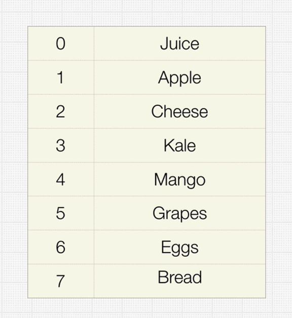

# Array

An array is a collection of items of some data type stored at contiguous (one after another) memory locations.

Arrays are probably the simplest and most widely used data structures, and also have the smallest overall footprint of any data structure.

Therefore arrays are your best option if all you need to do is store some data and iterate over it.

## Time Complexity

| Algorithm | Average case | Worst case |
| --------- | ------------ | ---------- |
| Access    | O(1)         | O(1)       |
| Search    | O(n)         | O(n)       |
| Insertion | O(n)         | O(n)       |
| Deletion  | O(n)         | O(n)       |

The space complexity of an array for the worst case is O(n).

## Types of Arrays

### Static arrays:

The size or number of elements in static arrays is fixed. (After an array is created and memory space allocated, the size of the array cannot be changed.)
The array's content can be modified, but the memory space allocated to it remains constant.

### Dynamic arrays:

The size or number of elements in a dynamic array can change. (After an array is created, the size of the array can be changed – the array size can grow or shrink.)
Dynamic arrays allow elements to be added and removed at the runtime. (The size of the dynamic array can be modified during the operations performed on it.)

## When should an Array be used?

Arrays are excellent for quick lookups. Pushing and popping are really quick.

Naturally, having something organized and close to each other in memory speeds up processing because it is organized.

The only drawback is that whenever it's not at the absolute end of the array, we have to shift to race, which makes inserts and deletions take longer.

Finally, it has a fixed size if static arrays are being used.

As a result, you occasionally need to specify how much memory you will need and the size of the array you desire in advance.

However, we can avoid it if we utilize some of the more modern languages that support dynamic arrays.

### Arrays Good at 😀:

- Fast lookups
- Fast push/pop
- Ordered

### Arrays Bad at 😒:

- Slow inserts
- Slow deletes
- Fixed size\* (if using static array)
